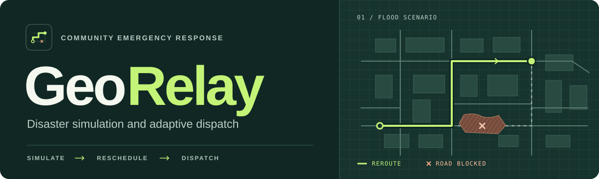

# GeoRelay

**面向社区的 Web 灾情推演与事件驱动应急任务重调度系统。**

当一条路突然不能通行，已经派出的任务怎么办？GeoRelay 在 Web 指挥台的三维社区地图上推演灾情，找出受影响的任务，比较绕行与改派方案。指挥员确认后，志愿者 Agent 模拟接单、执行和回报，进度与结果在同一个 Web 指挥台查看。项目只交付 Web 指挥台，不开发独立手机端。

**当前阶段：MVP 搭建中。** 本仓库已初始化文档与协作流程；下文描述首版目标。

[系统架构](docs/architecture.md) · [首版验收](docs/mvp.md) · [团队分工](docs/team.md) · [贡献指南](CONTRIBUTING.md)

## 一次看得见原因的改派

甲组正给 3 号楼送物资。降雨持续，前方路段超过演练设定的水深阈值。指挥员点开路段查看水深和判据，比较 **甲组绕行** 与 **乙组从备用物资点接手** 的预计耗时和需求缺口。确认改派后，代表乙组的 Agent 模拟接单和送达，地图同步显示执行轨迹与状态。另一条未受影响的任务继续执行。

| 产品能力 | 首版目标 |
| --- | --- |
| 三维指挥地图 | 在预置小区查看楼栋入口、路网、积水和受阻原因 |
| 增量式重调度 | 只重算受影响任务，保留仍可执行的安排 |
| Agent 模拟执行 | Web 确认派单；Agent 模拟接单、移动、受阻和完成，指挥台同步显示 |
| 演练复盘 | 保留原方案、事件依据、改派选择与执行记录 |

后续扩展火灾、地震及 Agent 模拟的自然语言上报。上报经人工确认后，复用同一个灾情事件入口。

## 参与项目

从 [首版验收](docs/mvp.md) 认领工作，用 Issue 记录范围和验收条件，用 PR 提交变更与验证证据。演练阈值与案例数据用于项目验证，实际系统接入与现场使用另行评估。
