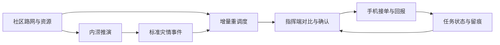

# 系统架构

GeoRelay 将灾情推演、调度求解和任务执行分开。各层共享同一份社区数据与稳定的对象 ID。

| 交接点 | 最小数据 |
| --- | --- |
| 灾情事件 → 规划器 | 事件 ID、发生时间、类型、路段或资源点 ID、判定依据 |
| 规划器 → 指挥端 | 关联事件、受影响任务、各候选的队伍、资源点、路线、预计耗时与需求缺口 |
| 指挥端 → 手机端 | 任务 ID、已确认的方案版本、执行队伍、目的地 |
| 手机端 → 指挥端 | 任务 ID、方案版本、状态、上报时间、可选备注 |

首版使用预置路网。规划器先识别受影响任务，再用 A* 计算可达性和绕行成本，结合库存、运力、时间窗和时限筛选候选。指挥员确认前，候选方案不会替换已生效的派单。后续的现场上报经人工确认后转成同类事件。
