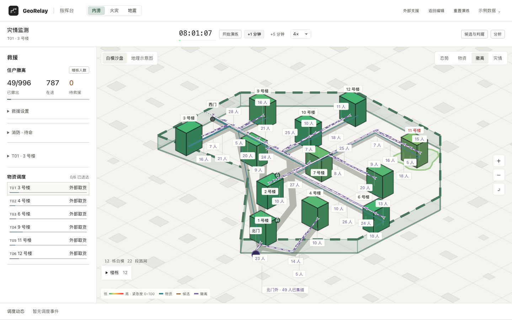
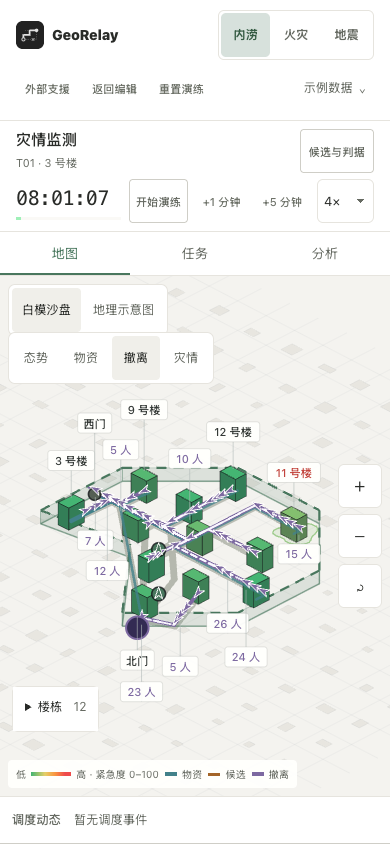

# 界面维护

界面围绕两件事组织：编辑社区、运行演练。模型和调度判定继续由 `src/domain/` 提供，展示层调用已有操作，不复制判定规则。

## 布局与交互

- 建模：一个编辑栏，按定位、围栏、楼栋、路网排列。栏底主按钮按 `communityReadiness.ts` 引导当前缺失步骤；入口回调复用同一判定，继续草稿只聚焦工具，不重置顶点。窄屏地图与编辑栏顺序排列。
- 指挥台：时钟、救援、地图、分析和调度记录使用 Grid 命名区域。桌面分析按需打开；900px 以下使用地图、任务、分析三个工作区，保留挂载与演练状态，面板内部滚动。救援配置、研判依据和图例使用原生 `details`。
- 演练时钟、下达撤离和确认改派是独立业务动作。仅有当前可确认候选时显示底部操作栏；当前任务、方案名称及送达时间始终与图上预览、候选卡和确认回调一致。候选不可行时保留校验原因；不显示可执行的确认入口。
- 候选与判据共用一个入口。抽屉使用原生 `dialog.showModal()`，Escape 关闭后返回触发器；确认后触发器若已消失，则聚焦常驻候选入口。手机抽屉底部保留当前方案的确认动作，不需要滚过任务列表。
- 文案只保留动作、数值、数据来源和需要处理的状态。成功通知短暂展示；错误及含撤销操作的通知由用户关闭。
- 保留示例地图标记、模拟参数来源、受阻原因和候选校验。可行性同时通过文字与状态表达。
- 样式在 `src/styles/app.css`，全局使用一套 `--gr-*` 变量。路线及人员状态颜色使用 `src/map/palette.ts`，Canvas、高德适配器、SVG 与图例共用；紧急度图例来自 `scene.ts` 的同一色阶，不更改风险计算。
- 地图默认只显示楼栋名称，当前图层、缩放、焦点及受阻状态决定标签优先级。`labels.ts` 在屏幕坐标中避让标签和控件；`MapObjects` 与图形共用楼栋派生数据，通过原生列表按钮键盘定位并查看详情。被省略的地图标注仍可从列表读取，不保存第二套对象选择状态。
- 控件使用原生按钮、表单标签和折叠区域。当前选择用 `aria-pressed`，折叠状态用 `aria-expanded`。地图缩放按钮在 DOM 中，可用键盘及自动化工具操作。
- `data-testid` 是自动化定位接口；修改可见文案时保留这些标识。新增测试优先通过角色、名称、状态操作，避免模拟鼠标坐标；只有地图几何绘制使用坐标。

## 调度反馈

- 地图流线只出现在实际行进的配送与撤离路段，偏移由同一个演练时钟驱动；人员以独立小箭头显示引擎真实位置和路径方向，不使用圆形底座或外圈，受阻用橙色和文字表达。暂停、受阻、交接和候选预览不制造运输进度。减少动态效果时去掉流动与入场动画，保留真实位置和状态。
- 调度记录只在真实新事件到来时短暂强调。顶部阅读时跟随最新，浏览历史或键盘聚焦时保持阅读位置；“返回最新”回到列表顶部。点击事件沿用原任务/楼栋回调，并切到手机地图工作区。
- UX：让行进、停顿和新变化可辨；DX：复用时钟、路径和事件，不增业务状态或动画依赖；AX：地图输出稳定的 `data-actor-id`、`data-motion-state`、`data-position`，事件保留 `data-event-id` 与原生键盘操作。

## 验证

开发服务启动后，使用装有 Playwright 的 Python 环境和系统 Chrome：

```sh
python3 -m venv .venv
source .venv/bin/activate
python -m pip install playwright
npm run dev
```

另一个终端激活同一环境，运行：

```sh
npm run build
npm test
npm run test:e2e
python scripts/layout_audit.py
python scripts/motion_check.py
npm run check:secrets
git diff --check
```

Windows 使用 `.venv\Scripts\Activate.ps1` 激活环境。`scripts/e2e_check.py` 保留旧入口，执行 `scripts/ui_check.py` 的当前测试。截图与结果写入忽略目录 `artifacts/`，浏览器使用隔离环境，不读取个人浏览记录。

UI 回归覆盖围栏、楼栋编辑与持久化、路网、三个灾种、地图图层、时钟、候选身份与确认、不可行候选、撤离、键盘焦点及手机工作区。布局审计覆盖 1440×900、1024×768、390×844，采集空白、错误、准备、运行、受阻、待确认及确认后截图，检查真实文字对比度、溢出和主要操作遮挡。无凭据时运行示例地图和规则模式；真实高德及外部模型服务需要配置后另行联调。

## 界面示例

以下使用内置演示社区，展示真实演练推进后的撤离状态。

桌面（1440 × 900）：



手机（390 × 844）：


